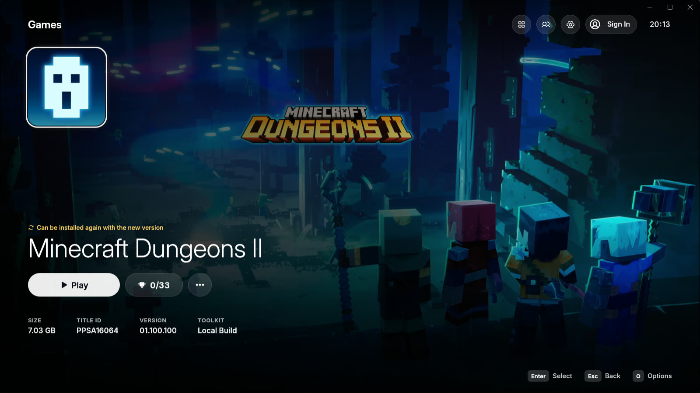
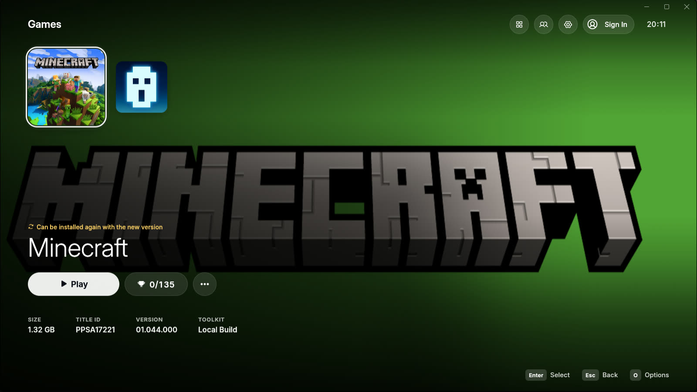
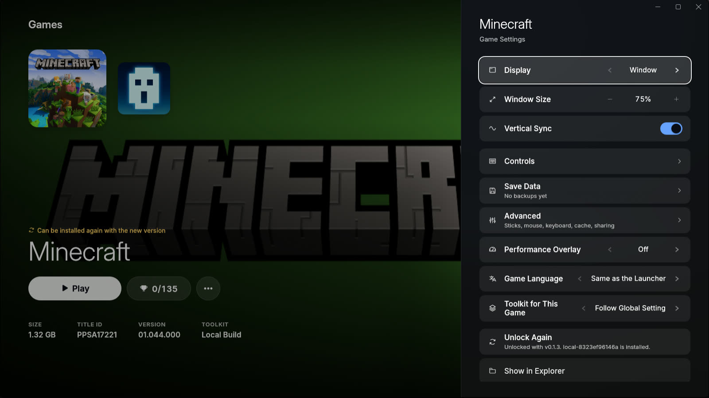
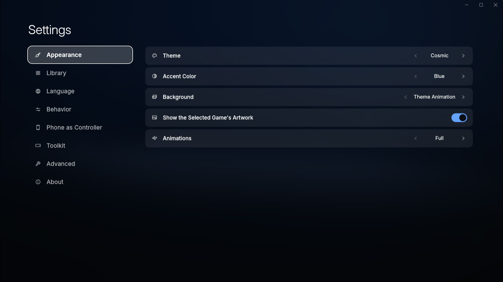
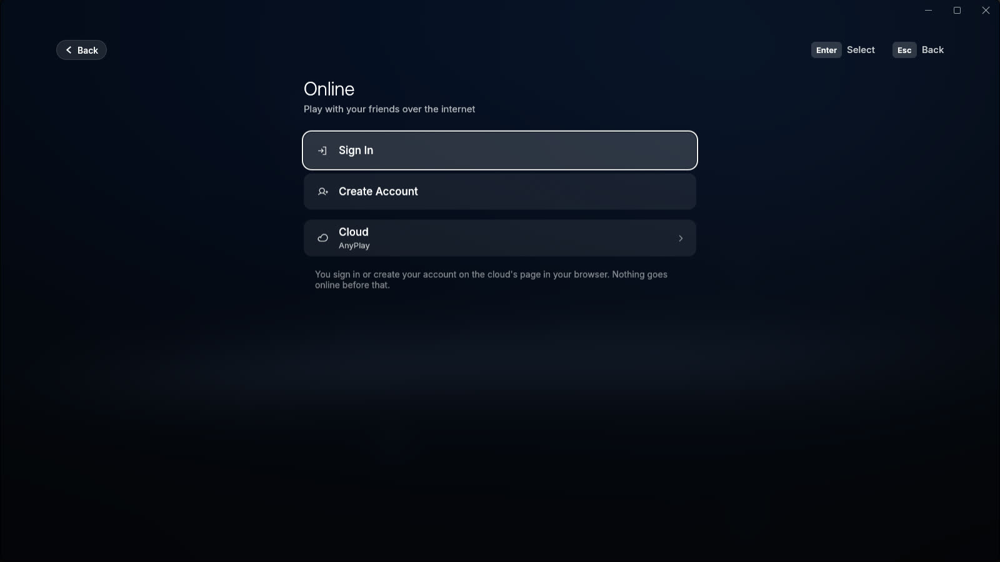

# AnyPlay Launcher

<p align="center">
  
</p>

The home of your games on PC. The launcher finds the games you dumped from your own console, unlocks them for [AnyPS5](https://github.com/boykopovar/AnyPS5) and starts them from a console-style home screen. It also connects you with friends for parties, calls and joining each other's games. For Windows and Linux.

## Get it

Download the [latest release](https://github.com/anyplaynet/launcher/releases/latest).

- **Windows 10 or 11:** `AnyPlay-Launcher-<version>-Setup.exe` (installer, no administrator rights) or `-x64.exe` (one file).
- **Linux, 64-bit:** `AnyPlay-Launcher-<version>-x86_64.AppImage` or the `.tar.gz`.

You need your own decrypted game dumps. On first start the launcher asks for your games folder and downloads the AnyPS5 toolkit. Requirements, SmartScreen, checksums and data folders: [docs/INSTALL.md](docs/INSTALL.md).

## Screens

Screenshots of the launcher, taken from a release build with a real library.

<table>
  <tr>
    <td width="50%"></td>
    <td width="50%"></td>
  </tr>
  <tr>
    <td></td>
    <td></td>
  </tr>
</table>

## What's inside

- **Library:** finds dumps in one folder, reads title, artwork and media from them, and never changes a dump.
- **Unlock and play:** turns a dump into a copy AnyPS5 can run, starts it, and tells you why it stopped if it fails.
- **Controls:** reads a game's controls from its own files, with ready-made keyboard and mouse layouts and tuning.
- **Trophies, saves, playtime:** trophies pop up while you play, saves are backed up before anything risky.
- **Per-game settings:** window, sync, overlay, language and shader cache, plus recommended settings you apply with one click.
- **Online:** friends, parties with voice, calls, profiles, a feed and join codes, with an AnyPlay account. See [docs/ONLINE.md](docs/ONLINE.md).
- **Updates:** signed self-update on Windows.

## Status

Released. The library, unlocking, controls and the online area work. No real game plays online yet: the bridge that connects a game to the network is still under review in AnyPS5. Linux has no self-update yet, and starting a game with the bridge is untested there. What is missing is listed in the [known gaps](https://github.com/anyplaynet/network/blob/main/docs/gaps.md).

## Build and contribute

You need Rust 1.95 and a checkout of [anyplaynet/network](https://github.com/anyplaynet/network) at the commit in `network.ref`:

```sh
cargo fmt --all -- --check
cargo clippy --workspace --all-targets -- -D warnings
cargo test --workspace
```

The details for each system and for releases are in [docs/BUILDING.md](docs/BUILDING.md); how the code fits together is in [docs/HOW-IT-WORKS.md](docs/HOW-IT-WORKS.md). Words are defined in [CONTEXT.md](CONTEXT.md). Until the network is live, only the AnyPlay team opens issues and pull requests; see [CONTRIBUTING.md](CONTRIBUTING.md).

## Community

Questions, bug reports and other players: the [AnyPlay Discord](https://discord.gg/9zYqf8fEsh). More about AnyPlay at [anyplaynet.com](https://anyplaynet.com).

## Credits, license and ground rules

GPL-2.0, see [LICENSE](LICENSE). The launcher began as a port of the macOS launcher by [utkuhalis](https://github.com/utkuhalis) in [AnyPS5-ARM](https://github.com/utkuhalis/AnyPS5-ARM) (GPL-2.0). Since then it has its own implementation, Windows and Linux integration and the online area. AnyPS5 is by [boykopovar](https://github.com/boykopovar). LudusCtrl protocol and app by Josip Parlov (@parl0v), see [parl0v/ludusctrl](https://github.com/parl0v/ludusctrl). Bundled fonts and icons are listed in [docs/supply-chain.md](docs/supply-chain.md#fonts-and-icons).

Ported files: the Rust files that began as ports of Swift files in AnyPS5-ARM name their source in their first line. They are `unwrap`, `library`, `unlock`, `toolkit`, `settings`, `controls`, `trophies`, `diagnosis` and `discord` in `anyps5-core`, and `app/model`, `ui/i18n`, `ui/i18n_table` and `ui/background` in `anyps5-launcher`. The mapping is in [docs/PORT.md](docs/PORT.md).

AnyPlay is a community project, not affiliated with the AnyPS5 maintainers or any platform holder. Only games you own: no game files, keys or firmware are included here, and none will be. AnyPS5 is a compatibility layer, not an emulator.
